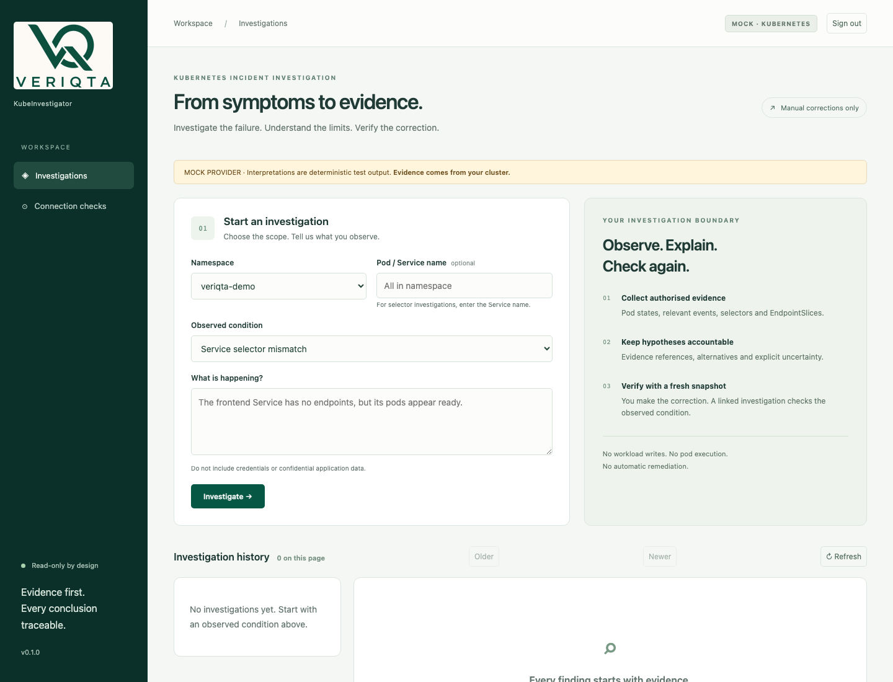
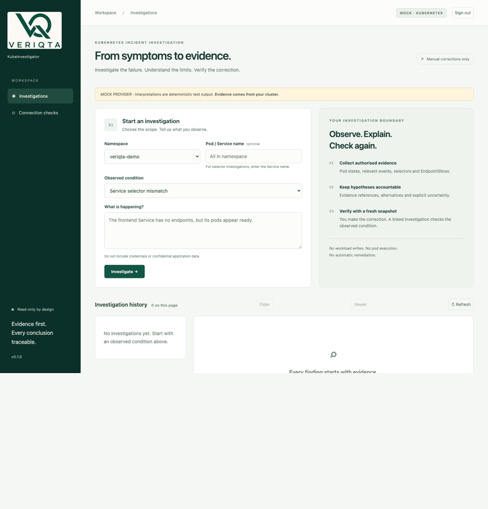
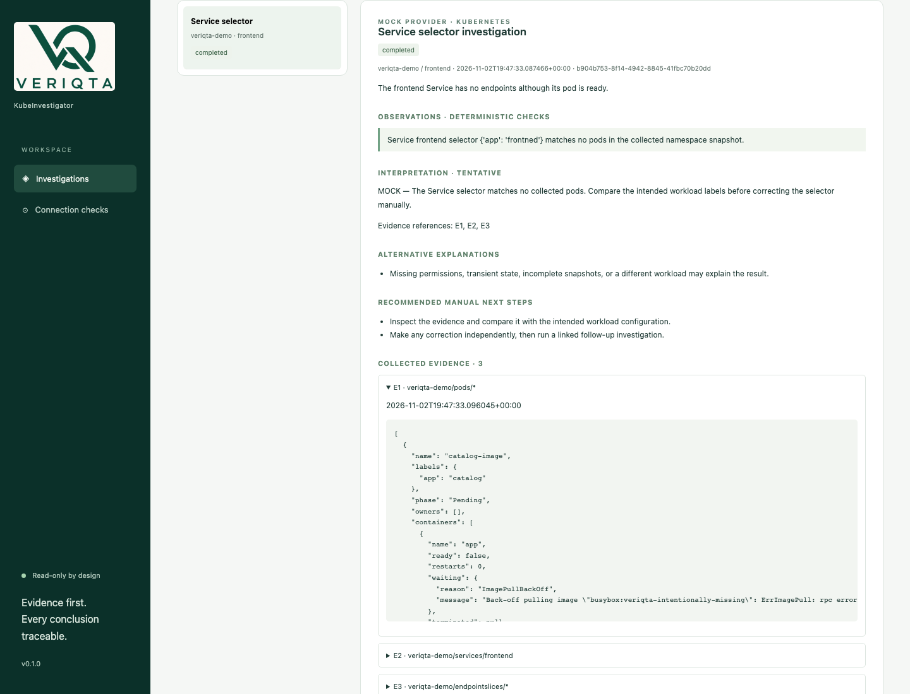
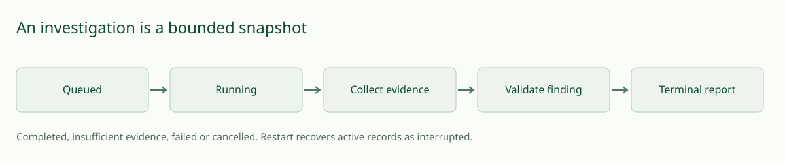
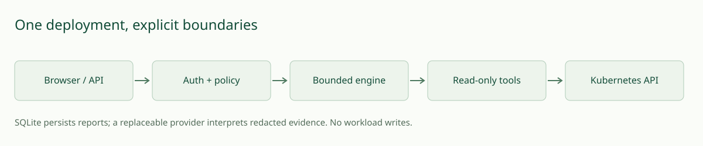
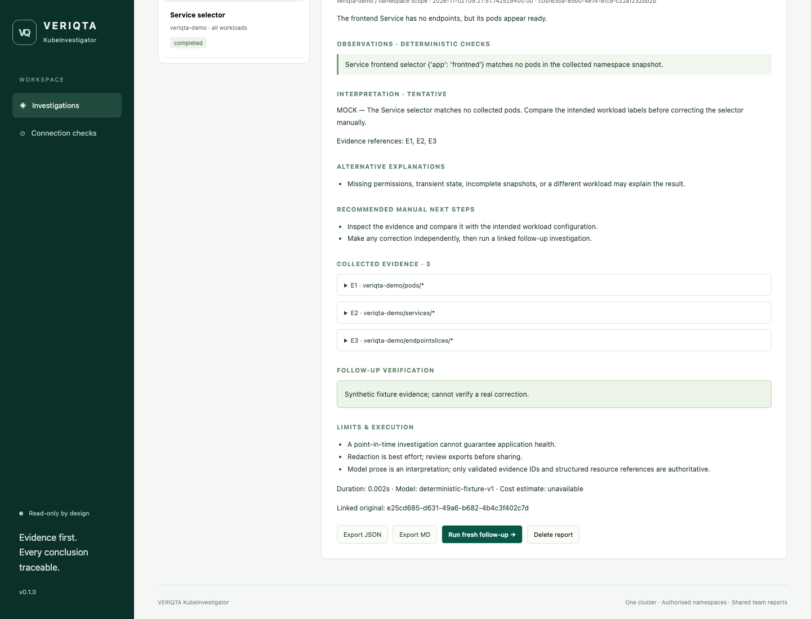

<p align="center"></p>

# VERIQTA KubeInvestigator

A self-hosted, read-only Kubernetes incident investigator that turns authorised cluster evidence into traceable findings and fresh follow-up checks.

 

[Quick start](#quick-start) · [Demonstration](#see-an-investigation) · [Documentation](docs/index.md) · [Security](SECURITY.md) · [Contributing](CONTRIBUTING.md)



*Actual 0.1.0 interface against disposable Kubernetes sample workloads. Evidence is real; interpretations use the MOCK provider. [Browser acceptance and genuine recording](docs/browser-acceptance.md). No live-model quality is implied.*

## Investigate the failure without handing over control

An application is unavailable. Its pods look ready, but traffic through the Service reaches nothing. The evidence is spread across pod status, selectors, EndpointSlices and events. KubeInvestigator brings that evidence into a bounded report, keeps observations separate from interpretations, and explains what remains uncertain. Engineers make corrections outside the application.

One deployment connects to one cluster, with explicit namespace scope and a shared authenticated team workspace. No VERIQTA account or private backend is required. You run the software with your own infrastructure and credentials.

## See an investigation

1. An engineer reports that the frontend Service has no endpoints.
2. The investigator collects Service selectors, namespace pod labels and EndpointSlices through read-only tools.
3. A deterministic check observes `app=frontned` selecting no collected pods labelled `app=frontend`. The report recommends comparing the intended labels before a manual change.
4. The engineer corrects the sample selector independently.
5. A linked follow-up collects fresh evidence. With complete real-cluster evidence it can say the previous condition is absent; it cannot guarantee that the whole application is healthy.



*Static sequence of genuine browser captures from disposable Kubernetes workloads; interpretations are MOCK. [Full follow-up screenshot](docs/assets/cluster/followup.png) · [Continuous browser recording](docs/assets/cluster/investigation.webm) · [Test evidence](docs/browser-acceptance.md). Corrections occur outside the read-only application; fresh evidence verifies only the previously observed condition.*



## Implemented scope

- CrashLoopBackOff: container waiting/restart/termination evidence and events; logs may be enabled explicitly.
- ImagePullBackOff: waiting messages and events; distinguish a pull condition from its possible causes.
- Service selector mismatch: compare selectors and pod labels with EndpointSlice evidence.
- Bounded investigation loop, server-side namespace/tool policy, cancellation and visible failure states.
- Shared-team sessions, SQLite persistence/retention, JSON/Markdown exports and linked fresh follow-ups.
- Separate fixture evidence, mock interpretations and opt-in OpenAI live-provider integration.
- Non-root Docker recipe, scoped Helm chart, disposable kind examples, component tests and CI/release preparation.

No autonomous remediation, shell execution, multi-cluster control or enterprise isolation is provided. [Scenario limitations](docs/scenarios.md) and [validation evidence](docs/validation.md) describe what is implemented versus exercised.

## Quick start

**Prerequisites:** Python 3.12+ linked to SQLite 3.54.1+ and internet for dependency installation. Use the [source interpreter setup](docs/installation.md#source-interpreter-setup) first; the application rejects older SQLite before opening a database. Run these commands from a checkout containing this source. No published container or Helm repository is assumed.

```sh
# Select a patched interpreter; the installation guide includes the macOS build.
python3.12 src/kubeinvestigator/sqlite_runtime.py
make setup PYTHON=python3.12
export KI_TOKEN="$(.venv/bin/python -c 'import secrets; print(secrets.token_urlsafe(32))')"
make run
```

Open **http://127.0.0.1:8080**, enter your generated team token, and start an investigation. Keep the token private. This default demonstration uses synthetic fixtures and a visibly labelled **mock provider**, requires no API key, and makes no model-provider call. Initial dependencies can still require internet access.

For **real Kubernetes evidence**, use the [disposable kind demonstration](docs/installation.md#real-kubernetes-evidence-in-a-disposable-kind-cluster). It needs Docker, kind, kubectl and Helm, creates restricted runtime credentials and sample failures, and includes correction/cleanup commands. For an authorised cluster, follow [Helm installation](docs/installation.md#deploy-against-an-explicitly-authorised-cluster). The dedicated kind path passed locally on Kubernetes 1.35.8; deployment to other authorised environments remains operator-validated.

Live interpretation requires separately configured OpenAI API access and may incur provider charges. Infrastructure can also cost money. API access is not implied by a ChatGPT subscription. No live calls were made; see [provider setup, limits and evaluation](docs/provider.md).

## How investigation works



A request enters a bounded queue. Deterministic collection runs first. The optional live model can request only registered read tools with validated arguments. Application policy enforces namespace, resource, time, call, turn and payload limits. Reports validate evidence references and retain errors and truncation. Unavailable providers produce an honest failed report; they never silently switch to mock. A restart marks unfinished persisted work interrupted.

## Architecture and permission boundaries



FastAPI serves the static interface and typed API. The official Kubernetes Python client runs blocking calls off the event loop. SQLite WAL stores reports for a **single process and single replica**; no HA is claimed. Roles in each configured namespace grant explicit get/list access to selected resources. Runtime credentials cannot read Secrets, write workloads, exec into pods, impersonate users or inspect nodes. [Architecture and decisions](docs/architecture.md) · [Security and data boundaries](docs/security.md)


*Third-party marks are attributed in the [asset inventory](docs/assets/README.md); inclusion does not imply endorsement.*

## What a report contains

A report includes UTC timestamps, scope and problem, lifecycle status, software/provider/model details, deterministic observations, a qualitative interpretation, evidence IDs and selected resource fields, alternatives, missing/truncated evidence, manual next steps, limitations, usage where supplied and related follow-up IDs. Cost is unavailable unless established; no confidence percentage is invented.

For the Service story, the observation is “selector matches no collected pods”; the hypothesis is “the selector may differ from intended workload labels.” Missing permissions, truncated snapshots and transient rollouts remain alternative explanations. [Report schema and API](docs/api.md) · [Real mock-backed report screenshot](docs/assets/screenshots/report.png)



## Deployment and compatibility

Local fixture/mock operation is validated on macOS arm64 with Python 3.12.14. The complete kind smoke passed with Helm 3.19.0 and Kubernetes 1.35.8 on a Linux arm64 Colima runtime. Kubernetes **1.35–1.37 is the target range**, derived from upstream maintained versions; 1.36/1.37 and Linux amd64 execution remain unverified. Linux and WSL2 host installation paths remain unverified. No managed-cloud distribution is certified. [Compatibility matrix](docs/compatibility.md)

Default access is localhost or an internal ClusterIP Service. Shared access requires opt-in TLS ingress, operator-supplied infrastructure and secure cookies. Storage, controller, DNS and CNI requirements are explicit in [installation](docs/installation.md).

## Security, data and costs

All authenticated team members share all reports. Keys remain on the server. Logs are disabled by default; selected evidence is minimised, redacted and bounded before provider use. Redaction has residual limitations. OpenAI receives redacted problem/evidence only when explicitly enabled. Reports are retained for seven days by default, with deletion and capacity limits. History uses bounded summaries; full evidence is fetched separately. Offline maintenance validates schema/integrity and preserves a pre-restore snapshot. No analytics or default external telemetry export is enabled. [Data flow](docs/security.md) · [Storage and monitoring](docs/operations.md) · [Configuration](docs/configuration.md)

## Evaluation evidence and limits

**Security gate:** the runtime uses a pinned official Python/Alpine base and an isolated installation stage, with no runtime pip or build toolchain. Known findings, exact final-image scans and remaining release blockers are recorded in the [release-readiness report](docs/release-readiness.md). A smaller image does not establish vulnerability-free or production-ready operation.

Local tests exercise policy, authentication, redaction, lifecycle, provider parsing/failure handling, payload/time/turn limits and the three fixture/mock API workflows. A browser run exercised the actual UI. These checks do not establish model diagnostic quality. Same-schema Helm configuration upgrade/rollback and offline PVC backup/restore have also passed in a focused disposable test. The Kubernetes 1.35.8 / Linux arm64 smoke passed with real evidence, restricted RBAC checks, persistent reports and three corrected/freshly verified incidents. Other target versions/architectures and paid live evaluations remain unrun. See the [runtime acceptance record](docs/runtime-acceptance.md). [Actual validation results](docs/validation.md) · [Requirements checklist](docs/requirements.md)

## Documentation and next steps

Start at the [documentation index](docs/index.md) for installation, scenarios, API, operations, security, evaluations, asset regeneration and releases. [Roadmap](ROADMAP.md) focuses first on real-cluster and live-provider acceptance, then gaps observed there. [Milestones and checkpoint](docs/checkpoint.md) preserve unfinished work.

Contributions are welcome through the [development guide](CONTRIBUTING.md) and repository issue templates. See [conduct](CODE_OF_CONDUCT.md) and [security reporting](SECURITY.md); do not disclose vulnerabilities publicly. There is no support SLA. Code is licensed under [Apache-2.0](LICENSE); supplied VERIQTA branding has separate rights and commercial code use does not imply endorsement. Third-party notices are recorded with assets and release SBOM preparation. [K8sGPT, HolmesGPT and OpenTelemetry Demo references](docs/architecture.md#reference-review-2026-11-01) informed documentation patterns; no affiliation, partnership or superiority is claimed.
