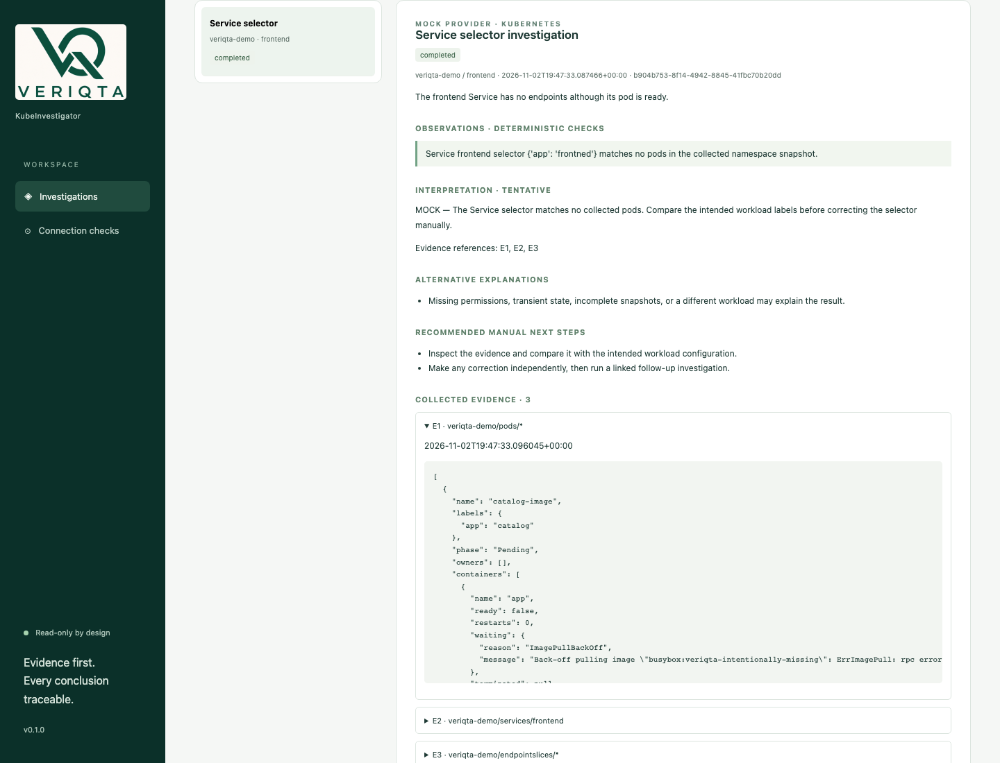
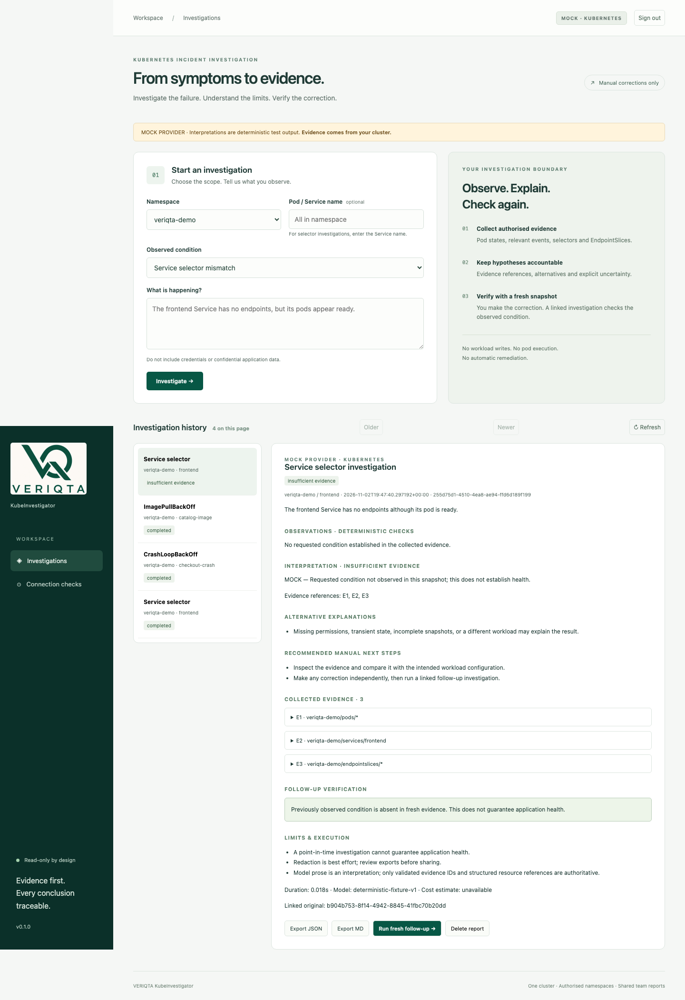

# Real-cluster browser acceptance

The recorded [browser run](acceptance/2026-11-02-complete-browser-demo-mock.json) exercised the installed Helm application on disposable local kind Kubernetes 1.35.8 / Linux arm64. The complete-demonstration run used application source at 7d21ec7; its updated recording harness was in the working tree and is identified by hash. Earlier dated runs remain available separately. The later complete-demonstration run and the native amd64 hosted run use matching kubectl1.35.8. The manifest records the harness and asset hashes. Evidence came from real Kubernetes resources; all interpretations used the deterministic **MOCK provider**. The workloads were disposable samples, not production data. This does not validate live-model accuracy.

Browser assertions covered unauthenticated denial, login, submissions for all three conditions, evidence expansion, JSON/Markdown downloads, exact report retention after deployment restart, expired sessions, three corrections through external installer scripts, newer evidence timestamps in linked follow-ups and logout invalidation. The wrapper verified deletion of its owned cluster. No provider credentials or paid requests were involved.





[Browser recording](assets/cluster/investigation.webm) · [Workspace screenshot](assets/cluster/overview.png) · [Capture manifest and hashes](assets/cluster/manifest.json). The complete recording covers incident submissions, restart/reauthentication and follow-up verification after external corrections. Password entry uses a masked input; no browser storage-state file or credentials are distributed.

## Reproduce

Use the Docker/kind/kubectl/Helm prerequisites and patched Python environment in [installation](installation.md). Node 22+ and the locked optional authoring tools are additionally required:

```sh
cd scripts/asset-tools
pnpm install --frozen-lockfile
pnpm exec playwright install chromium
cd ../..
NODE_PATH="$PWD/scripts/asset-tools/node_modules" VENV=.venv-source \
  KI_ACCEPTANCE_SUITE=browser bash scripts/smoke.sh
```

Select a local Unix-socket Docker runtime. The wrapper refuses occupied cluster names, isolates installer kubeconfig, builds/installs the chart and cleans up only its owned cluster. Captures are regenerated under docs/assets/cluster. With the pinned optional Pillow environment, run `python scripts/cluster_demo.py` to regenerate the static GIF sequence. Use a new date/revision record when retaining a later result. Retain the fixture captures separately: they test a different evidence source.

The [native amd64 hosted browser result](acceptance/2026-11-02-hosted-first-release-browser.json) independently passed the same journey at head50c30af; that earlier recording harness did not yet retain its follow-up video segment.
