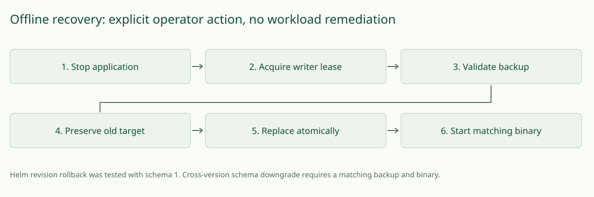

# Operations, storage and troubleshooting

Deploy one replica and one Uvicorn worker. SQLite WAL requires a writable local/PVC filesystem with reliable file locking; do not place multiple app processes on the same file or use network storage without checking SQLite locking semantics. The chart uses Recreate to avoid overlapping writers during rollout. It retains the 1Gi PVC by default. Requests are serialized through a connection lock; investigation concurrency is two. No HA or cross-process queue is provided.

Reports are bounded by default to 500 rows and a 100MB database/WAL admission threshold. Each investigation is bounded to eight 16KB evidence records plus its report. New jobs receive HTTP 507 when admission limits are reached; in-flight jobs may grow storage beyond the threshold by their bounded report sizes. This is an admission strategy, not a filesystem quota. Reserve extra free space and monitor the volume. SQLite disk-full errors can prevent terminal status persistence; logs contain a storage-error counter and restart marks any retained in-flight records interrupted. Back up before recovery; free capacity without deleting unknown files.

Retention is seven days, configurable to 1–90 days, evaluated every 60 seconds and before accepting new jobs. Active jobs are excluded from cleanup. Export and delete reports through authenticated API/UI. Deleted pages can remain inside the SQLite file; offline compaction reclaims space. Backups need a separate retention policy. Do not promise secure erasure from historical snapshots.

## Backup, restore and schema changes

Use the integrity-checked [maintenance commands](#verified-maintenance-commands) below. Stop the single application writer first. For Kubernetes, the focused disposable recovery test supplies the scale-to-zero, hardened Job, restore and startup sequence; adapt it only with explicit authorisation for your deployment/storage system. Do not copy a live main DB while ignoring its WAL. Encryption and independent backup retention remain operator responsibilities.

See [measured operating limits](operating-limits.md) for a bounded baseline and conservative small-team starting allocation.

## Operational signals

`GET /metrics` requires team authentication and returns Prometheus text. Counters include completed/failed/insufficient_evidence/cancelled/interrupted outcomes when executed, duration_milliseconds, tool_calls/tool_milliseconds/tool_errors, provider_errors, prompt_tokens/completion_tokens/total_tokens, budget_exhausted, storage_errors and cleanup_errors. Queue_depth and active are gauges. Only observed signals appear. Metrics reset on restart; persistent reports are the historical record. No cost value is invented. Request logs contain opaque request IDs; investigation lifecycle logs contain investigation IDs and status. The application logger emits these records at INFO without request bodies; supplied server commands disable access logs.

Optional OpenTelemetry export can use a separately installed Collector with the [example](../examples/otel-collector.yaml). The Collector scrapes authenticated metrics and exports OTLP to your chosen backend. It is not required, installed or enabled by default; configure its bearer-token file, network access and OTLP TLS credentials yourself. No dashboard or external backend is claimed to exist. Avoid adding namespace/report IDs or sensitive content as metric labels.

See the [installation troubleshooting table](installation.md) for symptoms and actionable checks. Diagnose storage, RBAC and provider configuration separately; readiness only confirms that persistent storage is readable.

## Verified maintenance commands

The application now holds an exclusive OS file lease on `KI_DATABASE.lock`. A second process or maintenance command refuses to open a live database. Do not delete the lock file to bypass it; the OS releases the lease on process exit. This requires reliable POSIX locking (Linux, macOS and WSL2); multi-writer/network filesystems and multiple workers remain unsupported.

Stop the application before each command. These are operator-only local CLI commands, not web endpoints, and require no provider key or Kubernetes credential:

```sh
.venv/bin/python -m kubeinvestigator.maintenance check --database .data/investigations.db
.venv/bin/python -m kubeinvestigator.maintenance backup --database .data/investigations.db --file /PRIVATE_BACKUP_DIRECTORY/investigations-2026-11-02.db
.venv/bin/python -m kubeinvestigator.maintenance restore --database .data/investigations.db --file /PRIVATE_BACKUP_DIRECTORY/investigations-2026-11-02.db
```

Replace `/PRIVATE_BACKUP_DIRECTORY` with a private directory you own; choose a new filename for each backup. Backup destinations are never overwritten. Restore checks SQLite integrity, schema 1 and report identities before modifying the target. It preserves a private `investigations.db.before-restore-*` snapshot, checkpoints the stopped target's WAL, prepares a verified replacement, then replaces the main file atomically with permissions 0600. It syncs the replacement and parent directory. Filesystem/power-loss guarantees still depend on the storage system; this is not a disaster-recovery certification. Archive pre-restore snapshots securely after review; they consume storage and can count against the database-family byte threshold.



If the existing target is corrupt or has an unsupported schema, restore refuses to discard it because it cannot create a validated prior snapshot. Recover to a new, nonexistent private database path, check it, then change `KI_DATABASE` while the application is stopped. Preserve the damaged main/WAL/SHM files together for diagnosis; do not delete or overwrite them. For example, use the restore command above with `--database .data/recovered.db`, then run `check --database .data/recovered.db`. Local tests verify fresh-path recovery and preservation of a corrupt target; physical volume replacement remains unverified.

A valid backup can include committed WAL data from an abruptly terminated process. Local tests verify that recovery preserves reports and marks unfinished jobs interrupted; newer or malformed schemas are rejected without replacing the target. The schema 0→1 migration is transactional and rejects unrecognised tables rather than silently adopting a different database.

Report-save failures roll back the transaction. The API returns a credential-free HTTP 507 message on storage errors; readiness returns 503 if storage cannot be read. In-flight terminal-state persistence can still fail on a truly full filesystem: preserve the files, free space and restart so retained unfinished records become interrupted. Tests induce SQLite's real `SQLITE_FULL` using a page limit; they do not fill the host disk or prove every physical I/O failure mode.

## Focused real-cluster recovery verification

```sh
# Local Docker, kind, matching kubectl, Helm and Python setup as in runtime-acceptance.md
KI_ACCEPTANCE_SUITE=recovery bash scripts/smoke.sh
```

This uses the same owned disposable cluster/credential cleanup wrapper, but runs `scripts/recovery.py` rather than repeating the three-incident smoke. It verifies one real-evidence report, Helm retention configuration 7→8, rollback to revision 1, exact report preservation, application scale-to-zero, a hardened credential-free maintenance Job on the PVC, authorised deletion, offline restore/integrity check, exact restored report, bounded history and a fresh linked investigation. Its [actual result](acceptance/2026-11-02-storage-recovery-mock.json) is recorded separately. It does not test a nonexistent previous release or imply arbitrary database-schema downgrade compatibility. Future schema migrations require a matching pre-upgrade backup and tested binary pair before version rollback is advertised.
