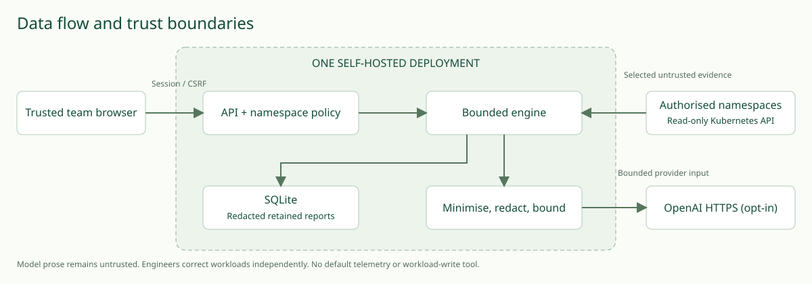

# Security, authentication and data boundaries

The access model is one trusted team sharing one deployment. Every authenticated user can inspect, export, follow up, cancel and delete every report. UUIDs are not an isolation boundary. This is not enterprise multi-tenancy or an individual audit identity system.

Configure KI_TOKEN to a randomly generated value of at least 32 characters. No default is accepted. Browser login exchanges it for a random HttpOnly SameSite=Strict cookie; the server stores only the cookie digest. Expiry defaults to one hour, without sliding renewal. Logout removes that session. Restart removes all sessions. Rotate the token and restart to invalidate all sessions and API clients. Tokens are never placed in URLs or persistent browser storage. Cookies require TLS for shared access; `KI_SECURE_COOKIE=true` enforces the browser Secure attribute. False is only appropriate for localhost port-forward. CSRF headers are required for cookie-authenticated writes; Bearer API requests do not use ambient cookie authority. The frontend holds its CSRF token in memory and requires sign-in again after reload. API clients must protect the bearer token. Login is capped at 10 attempts/minute/IP and all HTTP requests at 180/minute/IP; one process holds bounded ephemeral counters. Proxy headers are not trusted for client IP isolation. Behind a reverse proxy these limits may apply to all users together. Add edge rate limits before exposing a deployment broadly.

All namespace checks are server-side and repeated in the collector. The namespace selector comes from configuration. A single cluster is configured by in-cluster service account or restricted kubeconfig; the application never lists all namespaces. Do not run it locally with an administrator kubeconfig. Demo deployments use the restricted in-cluster service account. Kubernetes Roles allow only get/list on pods, events, services, deployments, replicasets, and EndpointSlices. Optional pods/log allows get only. No Secrets, nodes, exec, proxy, port-forward, impersonation, cluster role or wildcard permission is granted. A cluster installer necessarily needs permissions to create these scoped resources; users of the application do not need installer credentials.

## Data flow

The browser sends a problem, namespace, optional resource name and scenario. These are redacted before persistence/model use. The collector selects status, labels, ownership names, selectors, event messages and readiness summaries; it omits environment values, commands, annotations, image pull credentials, full specs and full manifests. Events and opt-in logs can still contain confidential application content. Regex redaction masks common credentials and URLs; arbitrary secrets, PII, encoded data and unusual formats can remain. Operators should restrict namespaces, leave logs disabled and review exports. Do not submit secrets in problem statements.

SQLite stores redacted evidence and reports for seven days by default. Logs share this retention, not indefinite retention. A 60-second cleanup loop and admission cleanup remove expired terminal reports. Deleting a report removes its row; it does not promise forensic erasure from SQLite pages, WAL, snapshots or operator backups. See [operations](operations.md) for compaction and backup retention.

With `provider=openai`, redacted problem/evidence/observations and the tool schema leave the deployment for the fixed HTTPS OpenAI API endpoint. Keys remain server-side. Mock mode makes no provider call. Installation can still download dependencies/images. No analytics, tracking pixels or default telemetry export is present. Optional OpenTelemetry collection must be installed and configured deliberately by the operator. Structured request logs contain request ID, method and response status; investigation logs contain ID and status. Metrics have fixed labels and no problem, namespace or evidence content. Provider exception bodies are never exposed or logged. HTTP server access logs are disabled in supplied commands to avoid query-string logging.

## Untrusted content

Prompt instructions in logs cannot add tools, namespaces, destinations or operations. Tool schema and policy run before every call. JSON provider output is validated; unknown evidence IDs or structured resource references reject the finding. Free-text diagnoses can still be wrong. All UI content uses textContent and native DOM nodes, never innerHTML. Evidence URLs do not become clickable links. Exported Markdown escapes HTML and Markdown syntax. A restrictive CSP, no CORS allowances and nosniff headers are set. These specific controls and tests do not prove all prompt injection is solved.

## Network and deployment

Use an internal ClusterIP Service and localhost port-forward by default. For shared deployments, use authenticated HTTPS ingress and private network controls. Drop capabilities, disallow privilege escalation, run UID/GID 10001 with a read-only root filesystem; PVC /data and bounded emptyDir /tmp are writable. No host filesystem or Docker socket is mounted. Single-replica storage and the cluster/API/provider are separate trust boundaries. See the optional [network policy](../examples/network-policy.yaml): its broad HTTPS egress is only a starting point, not an exfiltration guarantee. CNI enforcement, API server routing, DNS and provider IP changes require operator-specific policy.

The [threat model](security/threat-model.md), [security verification matrix](security/verification-matrix.md) and [secure deployment checklist](security/secure-deployment.md) track the additional security specification and remaining limitations. Kubernetes connections explicitly reject disabled certificate verification or HTTP API endpoints. Security events now include UTC timestamps, action names and request/investigation correlation IDs; no credential or raw evidence fields are accepted by the event helper. These logs are not tamper-proof audit storage.
